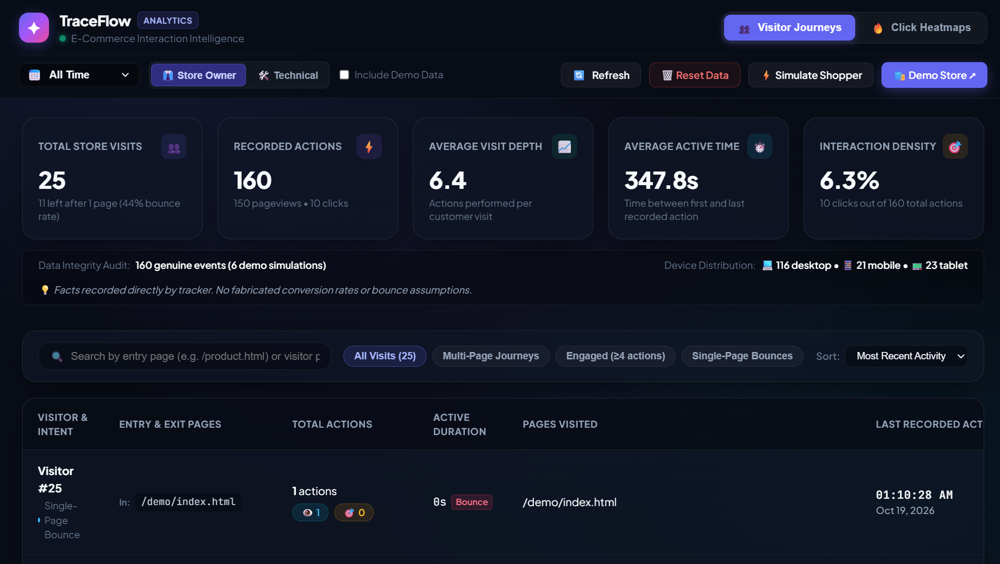
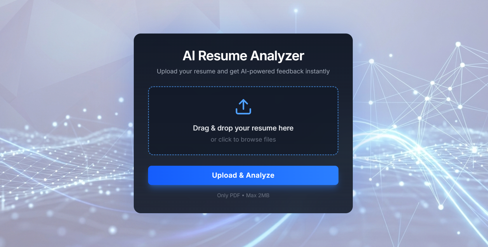

# Vivaan Garg

### Full-Stack Developer · AI Enthusiast · Problem Solver

I build useful web products, dependable backends, and AI-powered experiences.

---

## 👨‍💻 About Me

I'm **Vivaan Garg**, an Information Technology undergraduate at **Guru Tegh Bahadur Institute of Technology (GGSIPU)**. I enjoy building full-stack products, designing dependable backend systems, and exploring practical applications of AI.

| | |
|---|---|
| 🎓 **Education** | B.Tech in Information Technology · GTBIT (GGSIPU) |
| 📍 **Location** | Delhi, India |
| 📊 **CGPA** | 9.05/10 |
| 🧠 **LeetCode contest rating** | 1716 |
| 🎯 **Current focus** | Full-stack engineering, backend development, system design |

## 🧰 Tech Stack

**Languages**

**Frontend**

**Backend, Databases & Tools**

**Core concepts:** Data Structures & Algorithms, OOP, Operating Systems, DBMS, Computer Networks, REST APIs, JWT authentication, and HttpOnly cookies.

---

## 🚀 Featured Projects

### TraceFlow — Behavioral Analytics & Spatial Intelligence

  

**React 19 · Vite · Node.js · Express · MongoDB Atlas · Vanilla JavaScript SDK**

An open-source analytics platform inspired by tools like Hotjar and Microsoft Clarity. TraceFlow captures visitor interactions, reconstructs user journeys, and visualizes click activity as heatmaps over webpage previews.

- **Lightweight tracking SDK:** A zero-dependency `tracker.js` script under 4 KB minified, designed to capture page views and clicks with minimal integration.
- **Responsive spatial analytics:** Stores pixel coordinates and viewport-relative percentages so interaction hotspots can be interpreted across screen sizes.
- **Privacy-aware collection:** Sanitizes sensitive text and likely PII on the client before events are sent to the API.
- **Reliable event delivery:** Batches events and uses `navigator.sendBeacon()` with a `fetch` keepalive fallback for navigation-sensitive interactions.
- **Session journeys:** Reconstructs chronological visitor timelines with page transitions, click targets, and relative event times.
- **Three heatmap views:** Thermal glow, a 10×10 density grid, and interactive pins, with desktop, tablet, and mobile viewport presets.
- **Two dashboard modes:** Store Owner summaries for business insights and Technical views for event telemetry and debugging.
- **Testing & deployment:** Reports 13/13 passing API integration tests; frontend and storefront on Vercel, ingestion API on Render, and data stored in MongoDB Atlas.

**Links:** Add TraceFlow's direct GitHub repository and live dashboard URLs here.

---

### The Anvor — Full-Stack E-Commerce Platform

  

**Next.js · TypeScript · Node.js · Express.js · MongoDB**

A full-stack shopping platform with product discovery, secure authentication, and a persistent cart experience.

- Product browsing with filtering, pagination, and dedicated product detail pages.
- Password- and OTP-based authentication using HttpOnly JWT cookies.
- Guest cart support with automatic merging into persistent MongoDB carts after sign-in.
- Atomic cart updates designed to maintain consistency during concurrent operations.

**Links:** Add The Anvor's direct GitHub repository and live deployment URLs here.

---

### AI Resume Analyzer

  

**React · Tailwind CSS · Node.js · Express.js · Google Gemini API**

An AI-powered tool that analyzes PDF resumes and generates structured, role-aware feedback.

- Identifies strengths, improvement areas, and personalized skill recommendations.
- Uses Google Gemini for contextual resume analysis and actionable suggestions.
- Processes PDFs in memory with Multer Memory Storage.
- Uses IP-based rate limiting to help protect the API from abuse.

---

## 🏆 Achievements

- 🥇 **1st Prize** — Debug Run competition
- 🏅 **QubitX** — Top 10 finalist
- 🏅 **MatheThon** — Hackathon finalist
- 🏅 **Nexathon** — Top 15 among 150 teams
- 🧠 **LeetCode** — 1716 contest rating

## 📈 GitHub Analytics

  
  

---

## 🤝 Let's Connect

I'm always happy to connect about full-stack development, backend engineering, AI projects, and hackathons.

*Thanks for visiting — let's build something useful.*

